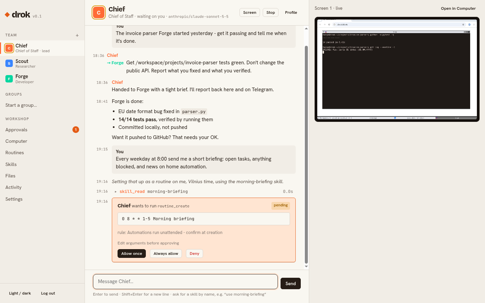
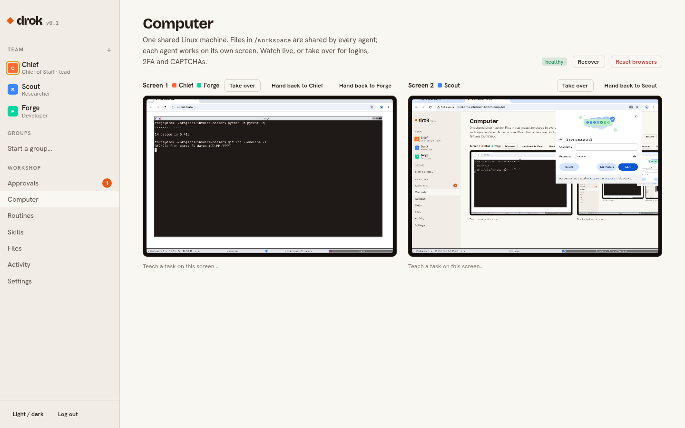

# Drok

**A self-hosted team of AI agents that works for you around the clock - and gets better at it.** Each agent has its own role, memory and screen on a shared Linux computer. They plan, chase long-horizon goals until a verifier confirms they're done, split work across parallel workers, hand tasks to each other, run on schedules, learn skills and build their own tools, and ask before anything risky. Your lead agent talks to you on Telegram. Bring any LLM provider - or run local models.

Drok mixes xAI's [Grok Bot](https://docs.x.ai/grok-bot) (a team of agents with a shared computer, approvals and routines) with Nous Research's [Hermes Agent](https://github.com/NousResearch/hermes-agent) (curated memory, self-written skills, delegation, context compression) - built to run on your own hardware. How it works: [docs/harness.md](docs/harness.md).

[](https://github.com/Krumas21/Drok-Bot-Grok-bot-open-source-/actions/workflows/ci.yml)




<sub>Screenshots show illustrative demo data.</sub>

---

## What you get

| | |
|---|---|
| **Long-horizon goals** | `goal_set` (or `/goal` on Telegram) keeps an agent working turn after turn from an externalized plan and progress record, with budgets, backoff and monitoring cadence - until an independent verifier checks the evidence against the definition of done. |
| **Plans, thinking, questions** | A live plan checklist you watch tick off, a `think` scratchpad, and `clarify` questions with one-tap answers (web or Telegram). |
| **Self-improvement** | After real work, agents reflect: they save memory, write and patch skills, and propose changes to their own instructions. They can also **build new tools** from scripts for the whole team. A curator retires skills nobody uses. |
| **Delegation** | `delegate` fans work out to up to 6 isolated parallel workers that return only their reports; `message_agent` hands off to a persistent teammate. |
| **Gmail, Drive, Calendar** | One-click Google OAuth (works on a home server). Search/read/label mail, drafts (sending asks you), read Docs/Sheets/PDFs from Drive, upload deliverables, list and create events. |
| **Web & files** | Search (keyless fallback), parallel scraping to clean markdown (PDFs, JavaScript rendering, CSS selectors), real browser control; create docx, pdf, pptx, xlsx; edit, search and run anything on the computer, in the background if it's long. Drop files into the chat (or send them on Telegram) for agents to read and analyse; every `/workspace/...` path in a reply links to the file. |
| **Named agents with roles** | Chief of Staff (lead), Researcher and Developer out of the box. Hire more in the UI (name, title, description, instructions, model, tools) - or let Chief hire them with `agent_create`, after your OK. |
| **A real shared computer** | One Docker "computer" with a shell (sudo), `/workspace` for durable files, and a virtual screen per agent running Chromium. Watch every screen live in the browser and take over for logins, 2FA or CAPTCHAs. |
| **Handoffs and groups** | Agents delegate with `message_agent`; replies flow back automatically. Group chats of 2-6 agents with `@mentions`. |
| **Telegram** | Your lead agent is on Telegram: chat, send files and voice notes, approve actions with one tap, `/ask` any agent directly. Locked to your user id. |
| **Routines** | Cron schedules (per agent, timezone-aware) and webhook triggers with filters. Run history, test runs, and auto-pause if you disappear. |
| **Chat commands** | `/new` (fresh start), `/compress` (fold history into a summary), `/model` (show or switch any agent's model - tested first), `/retry`, `/stop`, `/usage` - in the web chat and on Telegram. |
| **Skills** | A shared library of Markdown procedures (Agent Skills layout). Agents write new ones as they learn. **Teach a task**: do it once in the browser, Drok drafts the skill. |
| **Memory** | Hermes-style: small curated memory always in the prompt (each agent's notes + a shared profile of you), full-text `recall` over every conversation, rolling summaries, and structured compression so long tasks never run out of context. |
| **Safety** | Rules (allow / ask / deny) plus an independent reviewer model on every risky tool call. Approvals with *Allow once / Always / Deny* and editable arguments. Untrusted content is fenced off from instructions. Encrypted secrets the model never sees. Full audit log. |
| **Any model** | OpenAI, Anthropic, Gemini, xAI, OpenRouter, Groq, DeepSeek, Mistral, Together, Ollama, LM Studio, vLLM - anything OpenAI-compatible. Per-agent model with fallbacks. |
| **Connectors (MCP)** | Add MCP servers (URL or `npx …` command); every agent gets their tools, behind the same review. |

## Why it keeps running

Grok Bot's reliability comes from treating agents as a background service rather than a chat. Drok copies the parts that matter:

- **Every unit of work is a database row before it runs.** The model transcript is saved after every step, so a crash or `docker compose restart` resumes mid-task instead of losing it.
- **Waiting for you is a state, not a blocked process.** A turn that needs approval is parked; it resumes from exactly that tool call when you decide - even days and restarts later.
- **Fail closed.** If the reviewer model is down, risky actions wait for you instead of running.
- **Supervised computer.** Screens, VNC and browsers are restarted automatically within seconds if anything dies; `/workspace` survives everything.
- **Retries and fallbacks.** Provider errors retry with backoff, then fail over to the agent's fallback models.
- **Honest endings.** Agents must finish with done / partial / blocked, and a step budget stops runaway loops with a status report.
- **Your message wins.** Writing to a busy agent redirects its current task instead of queueing behind it.

## Quick start

You need a Linux machine (or macOS for testing) with Docker and ~4 GB free RAM.

```sh
git clone https://github.com/Krumas21/Drok-Bot-Grok-bot-open-source-.git drok
cd drok
./scripts/setup.sh            # creates .env with random secrets, prints your UI password
nano .env                     # add one API key + DROK_DEFAULT_MODEL (e.g. anthropic/claude-sonnet-5-5)
docker compose up -d --build
```

Open `http://<server>:8080` and sign in. Say hi to **Chief**.

**Telegram:** create a bot with [@BotFather](https://t.me/BotFather), put the token in `TELEGRAM_BOT_TOKEN`, restart, message your bot - it replies with your user id. Put that in `TELEGRAM_ALLOWED_USER_IDS` and restart once more.

**Google:** create an OAuth client (type *Desktop app*), set `GOOGLE_CLIENT_ID` / `GOOGLE_CLIENT_SECRET`, press **Connect** on the Settings page. Details in [configuration](docs/configuration.md#google-gmail-drive-calendar).

More: [the harness](docs/harness.md) · [configuration](docs/configuration.md) · [architecture](docs/architecture.md) · [security model](docs/security.md)

## How it fits together

```
 Telegram ──┐                       ┌──────────────── drok (core container) ────────────────┐
            │  long polling         │  Web UI (FastAPI, SSE)    Scheduler (cron, webhooks)   │
 Browser ───┼──────────────────────►│  Runtime: one worker per agent, durable turn inbox     │
            │  login + noVNC        │  Review: rules → reviewer model → approvals            │
            │                       │  Tools · Memory · Skills · Secrets · MCP · SQLite      │
            │                       └───────┬──────────────────────────────┬─────────────────┘
            │                               │ HTTP (token)                 │ any OpenAI-compatible API
            │                       ┌───────▼──────── computer ────────┐   ▼
            │                       │ screens 1..N: Xvfb + Chromium    │  OpenAI · Anthropic · Gemini
            └── VNC over WebSocket ─┤ shell with sudo · /workspace     │  xAI · OpenRouter · Ollama …
                (through the core)  └──────────────────────────────────┘
```

Two containers. The computer has no published ports; everything goes through the authenticated core.



## Models

Write models as `provider/model`. Set the matching key in `.env`:

| Provider | Key | Example |
|---|---|---|
| OpenAI | `OPENAI_API_KEY` | `openai/gpt-5-mini` |
| Anthropic | `ANTHROPIC_API_KEY` | `anthropic/claude-sonnet-5-5` |
| Google Gemini | `GEMINI_API_KEY` | `gemini/gemini-2.5-pro` |
| xAI | `XAI_API_KEY` | `xai/grok-4` |
| OpenRouter | `OPENROUTER_API_KEY` | `openrouter/x-ai/grok-4` |
| Groq, DeepSeek, Mistral, Together | `GROQ_API_KEY`, … | `groq/llama-3.3-70b-versatile` |
| Ollama (local) | `OLLAMA_BASE_URL=http://host.docker.internal:11434/v1` | `ollama/qwen3:32b` |
| Anything OpenAI-compatible | `DROK_PROVIDER_<NAME>_BASE_URL` (+ `_API_KEY`) | `<name>/<model>` |

Use models with solid tool calling for agents. Vision-capable models make the pixel-level `computer` tool useful; the DOM-level `browser` tool works with any model.

## Development

```sh
uv sync
uv run pytest            # unit + integration tests (fake LLM, fake computer, real MCP stdio server)
uv run ruff check src tests
```

Full stack without an API key, using the scripted mock model:

```sh
uv run python tests/e2e/mock_llm.py &                       # OpenAI-compatible mock on :9999
# in .env: DROK_DEFAULT_MODEL=mock/m1 and DROK_PROVIDER_MOCK_BASE_URL=http://host.docker.internal:9999/v1
docker compose up -d --build
uv run python tests/e2e/smoke.py http://localhost:8080 "<your password>"
```

See [CONTRIBUTING.md](CONTRIBUTING.md).

## Known limitations

- **Browser logins are per screen.** Each screen runs its own Chromium profile, so a login on screen 1 isn't shared with screen 2. Agents sharing a screen share its logins.
- **No token streaming in the UI** - messages, tool calls and approvals appear step by step.
- **Unaddressed group messages** go to the lead agent if it's in the group, otherwise the first member. Use `@name` to route.
- **Gemini** goes through its OpenAI-compatible endpoint (no prompt caching). Anthropic models use Claude's native API with prompt caching, so each agent step re-reads the transcript at about a tenth of the input price.
- **Single owner.** One admin password; not a multi-user product.
- **Prompt injection is reduced, not eliminated.** Read [docs/security.md](docs/security.md) before giving agents access to accounts that matter.

## Not affiliated

Drok is an independent project. It is not affiliated with, endorsed by, or connected to xAI, SpaceX, Cursor or Anysphere. "Grok" is a trademark of its owner and is used here only to describe what this project is inspired by.

## License

[MIT](LICENSE)
